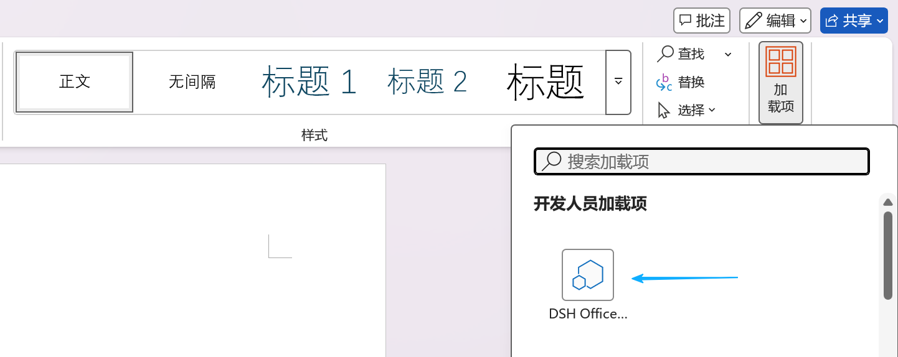
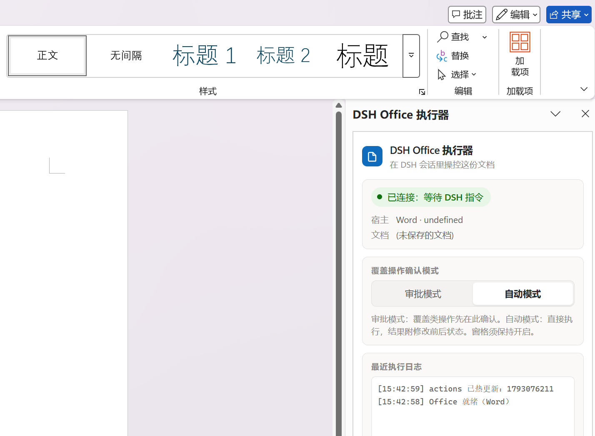

# dsh-ms-office

[](LICENSE) [](#compatibility) [](https://github.com/svkoh/dsh-ms-office/actions/workflows/ci.yml)

English · [中文](README.zh.md)

Read and write the Word, Excel and PowerPoint documents you have open from a [DeepSeek Harness (DSH)](https://github.com/deepseek-ai/deepseek-harness) session. The add-in edits the open document in place, so changes appear immediately and you can keep editing alongside it.

## Install

```bash
dsh plugin --profile web add @nanoai-dev/dsh-ms-office
```

Replace `--profile web` with the profile you normally run.

Or install from the GitHub repository:

```bash
dsh plugin --profile web add github:svkoh/dsh-ms-office
```

## First use

1. Open a Word, Excel or PowerPoint document in Microsoft Office desktop.
2. Open the add-in task pane and keep it open. If it does not appear, close and reopen the document.
3. Wait for "Connected — waiting for DSH commands".
4. In the dsh chat box, type "read the whole of the Word document I have open".

| Open the add-in task pane | Pane ready |
| --- | --- |
|  |  |

The pane can be shrunk or moved to a corner. It cannot be closed.

## Features

92 actions across Word, Excel and PowerPoint cover content, formatting, structure, tables, charts, formulas and comments. The full list is in [docs/CAPABILITIES.en.md](docs/CAPABILITIES.en.md).

## Troubleshooting

In the dsh chat box, type:

```
Check whether the dsh-ms-office plugin is working properly and fix it
```

## Documentation

| Document | Contents |
| --- | --- |
| [docs/CAPABILITIES.en.md](docs/CAPABILITIES.en.md) | Full action list and capability boundaries |
| [docs/AGENT.en.md](docs/AGENT.en.md) | HTTP endpoints, error codes, approval protocol |
| [docs/DEVELOPMENT.en.md](docs/DEVELOPMENT.en.md) | Architecture, file map, packaging, npm publishing |
| [docs/style-gallery.en.md](docs/style-gallery.en.md) | Style atlas previews |
| [docs/FEATURE-ROADMAP.en.md](docs/FEATURE-ROADMAP.en.md) | Planned work |

## Compatibility

Windows only. Other platforms are not supported.

## License

[MIT](LICENSE). The license and provenance of the third-party component (pako) are in [THIRD_PARTY_NOTICES.md](THIRD_PARTY_NOTICES.md).

This project is a fork of <https://github.com/Mikuzjc/dsh-office-for-mso>.
