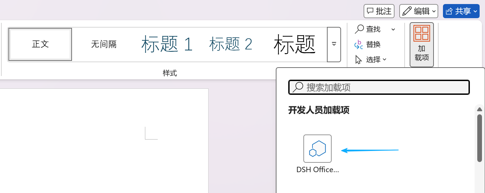
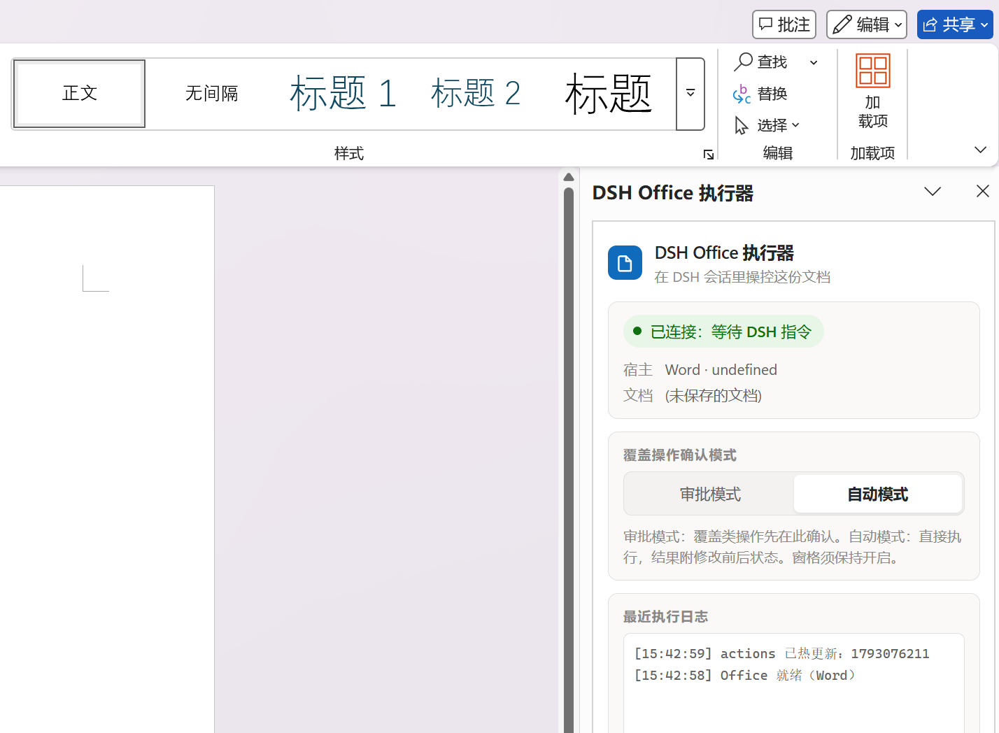

# dsh-ms-office

[](LICENSE) [](#兼容性) [](https://github.com/svkoh/dsh-ms-office/actions/workflows/ci.yml)

[English](README.md) · 中文

在 [DeepSeek Harness（DSH）](https://github.com/deepseek-ai/deepseek-harness) 会话里读写你已经打开的 Word、Excel、PowerPoint 文档。加载项在文档内部直接改动，改动立刻可见，你和 AI 可以同时编辑。

## 安装

从 npm 安装：

```bash
dsh plugin --profile web add @nanoai-dev/dsh-ms-office
```

`--profile web` 换成你平时用的配置名。

也可以从 GitHub 仓库安装：

```bash
dsh plugin --profile web add github:svkoh/dsh-ms-office
```

## 首次使用

1. 用 Microsoft Office 桌面版打开一个 Word、Excel 或 PowerPoint 文档。
2. 打开加载项窗格并保持打开；没出现就关掉文档重新打开。
3. 窗格显示「已连接：等待 DSH 指令」就可以开始了。
4. 在 dsh 聊天框输入「读一下当前 Word 的全文」。

| 打开加载项窗格 | 窗格就绪 |
| --- | --- |
|  |  |

窗格可以缩小或拖到角落，不能关闭。

## 插件功能

92 个 action 覆盖 Word、Excel、PowerPoint 的内容、格式、结构、表格、图表、公式与批注。完整清单见 [docs/CAPABILITIES.md](docs/CAPABILITIES.md)。

## 故障排查

在 dsh 聊天框输入：

```
检查 dsh-ms-office 插件是否正常工作，并帮我修好
```

## 文档

| 文档 | 内容 |
| --- | --- |
| [docs/CAPABILITIES.md](docs/CAPABILITIES.md) | 全部 action 清单与能力边界 |
| [docs/AGENT.md](docs/AGENT.md) | HTTP 接口、错误码、审批协议 |
| [docs/DEVELOPMENT.md](docs/DEVELOPMENT.md) | 架构、文件职责、打包约定、npm 发布 |
| [docs/style-gallery.md](docs/style-gallery.md) | 样式范本预览 |
| [docs/FEATURE-ROADMAP.md](docs/FEATURE-ROADMAP.md) | 后续计划 |

## 兼容性

仅支持 Windows，其他平台不兼容。

## 许可

[MIT](LICENSE)。第三方组件 pako 的许可与出处见 [THIRD_PARTY_NOTICES.md](THIRD_PARTY_NOTICES.md)。

本项目 fork 自 <https://github.com/Mikuzjc/dsh-office-for-mso>。
