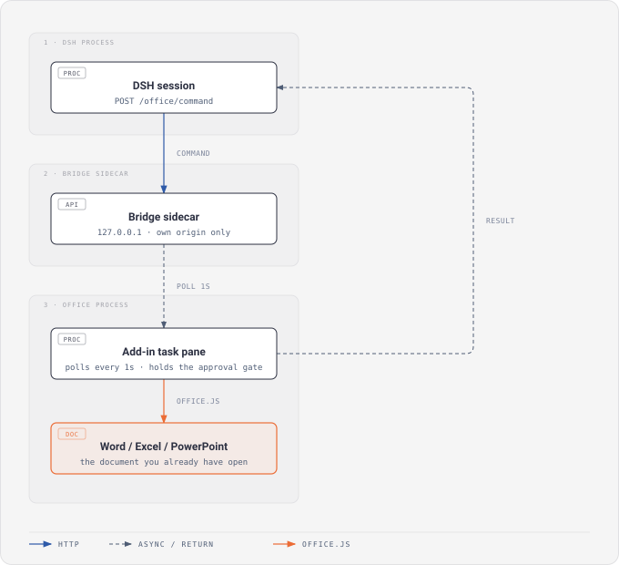
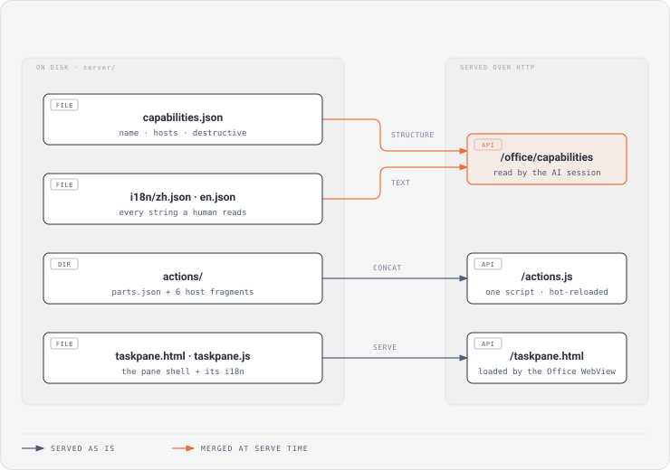

# 开发文档

> [English](DEVELOPMENT.en.md) · 中文

面向改这个插件的人。使用说明看 [README](../README.md)，接口协议看[集成方文档](AGENT.md)。

## 架构

### 运行时数据流



### 模块结构



### 文件职责

| 文件 | 职责 |
|---|---|
| `lib/index.js` | 插件宿主侧入口：拉起桥接服务、挂设置面板路由 |
| `lib/sidecar-host.mjs` | 桥接服务的生命周期：spawn、健康检查、端口选择、崩溃重启、退出清理；发布技能时按宿主语言在 `SKILL.md` / `SKILL.en.md` 之间二选一 |
| `lib/client.js` | 插件设置面板（状态灯 / 端口 / 自动启动开关） |
| `cordis.patch.yml` | 挂载本插件的 loader 行 |
| `server/server.js` | 桥接服务：指令队列、路由、心跳、能力发现、静态文件、按请求语言装配文案 |
| `server/taskpane.js` | 加载项窗格：轮询 / 心跳 / 分发 / actions 热更新 |
| `server/actions/` | **按宿主分片**的 action 实现：`word.js` / `excel.js` / `ppt.js` / `common.js`（宿主无关）/ `runtime.js`（共享运行时）/ `registry.js`（装配与对账） |
| `server/actions/parts.json` | 分片拼接清单（顺序 = 依赖顺序）；服务端与测试读同一份 |
| `server/capabilities.json` | **能力表的结构真源**：名称 / 平台 / 是否覆盖类 / requirement。人类可读的参数说明**不在这里** |
| `i18n/zh.json` · `i18n/en.json` | **所有文案的唯一真源**：窗格 UI、服务端消息与错误目录、能力参数说明 |
| `server/taskpane.html` | 窗格 UI 骨架（Fluent 2 语义色，跟随系统深色模式；可见文案全部由 `/office/i18n` 填入） |
| `server/manifest.xml` | Office 加载项清单模板（端口 3000；运行期按实际端口改写后写到 `$DSH_HOME/dsh-office-for-mso/manifest.xml`；显示名 / 描述带 `en-US` 覆盖） |
| `server/pako.min.js` | 解压 OOXML 用的 zlib 实现（第三方，见 [THIRD_PARTY_NOTICES.md](../THIRD_PARTY_NOTICES.md)） |
| `skills/office-for-mso/SKILL.md` · `SKILL.en.md` | 给 AI 看的技能说明（中文 / 英文两版，发布时二选一，只注册一个技能） |
| `docs/` | 文档与两张架构图（SVG 无外部字体依赖，浅色深色主题下都可读） |
| `test/` | 测试（`npm test`，零测试框架依赖，用 `node --test`） |

## 运行机制

### 多文档模型

每个窗格有自己的 `instanceId`。`GET /office/status` 返回在线文档列表，含 `docUrl`（文档路径，用来识别是哪一份）和 `docTitle`。发指令必须带 `instance`，否则拒绝——这是防止「多文档同时打开时指令被错误文档执行」的机制。

### 命令与健康状态

命令协议见[集成方文档](AGENT.md)。默认 `COMMAND_TIMEOUT_MS=180000`，审批最长 120 秒且不超过 `expiresAt`。所有窗格执行先原子 `/start`，结果携带 `instance` 和布尔值 `ok`；外部 `args.confirm` 被忽略，内部批准使用绑定命令的一次性闭包。执行中超时标为 `execution_unknown` 并保留实例占位直到迟到结果，避免盲重试重复写入。设置面板区分 `starting` / `healthy` / `unhealthy` / `stopped`，不能仅凭子进程存在判定服务可用。写后核验失败附 `verificationWarnings`，不误报已成功写入失败；回读不保证完整全文。

### 热更新

窗格每次轮询前比对 `/actions.js` 的版本（= 全部分片 mtime 的最大值），变了就动态重载；心跳里还会比对 `server/taskpane.js` 与 `i18n/*.json` 的 mtime（`codeVersion`），变了就自动 reload 整个窗格。

所以改完代码**重启桥接服务**即可生效。注意 `codeVersion` 覆盖 `i18n/*.json` 是必须的——否则改一个字符串不会触发重载。

### 端口与 bridge.json

默认 `127.0.0.1:3000`，可在插件设置面板里改；端口被占用时插件另选空闲端口，并同步改写加载项清单里的地址。改端口后用户需要关闭并重新打开 Office 文档（加载项地址写在清单里，Office 只在加载文档时读一次）。

服务启动时把当前地址写成 `$DSH_HOME/dsh-office-for-mso/bridge.json`：

```json
{ "plugin": "dsh-office-for-mso", "url": "http://127.0.0.1:3000", "port": 3000, "pid": 1234, "startedAt": "…" }
```

这个文件是给**调用方**（AI / 脚本）看的——它们看不到插件设置面板，端口又是可变的，所以必须有这么一个机器可读的落点。文件不存在就等于桥接服务没在跑。**删掉或改坏它不会有任何危害**，下次启动会重写。

### i18n

界面语言按这个顺序决定：**`?lang=` → `Accept-Language` → 环境变量 `OFFICE_LANG` → 系统 locale → 中文**。以 `en` 开头取英文，以 `zh` 开头取中文，其余一律中文。

- **窗格**：读 `Office.context.displayLanguage`（用户在 Office 里设的编辑语言），再回退到 `navigator.language`；启动时向 `GET /office/i18n?lang=` 取字典，**拿到之前不渲染状态文案**（否则会先闪一个「已连接」再翻成错误）。
- **服务端**：`/office/capabilities`、`/office/errors`、`/office/i18n` 都返回 `lang` 字段，正文按该语言装配；启动日志也走同一套字典。
- **加语言**：`i18n/` 下加一个 `<lang>.json`，把它加进 `server/server.js` 的 `LANGS`；`test/i18n.test.mjs` 会强制两侧键集与占位符集完全一致。清单里的显示名再加一条 `<Override Locale="…">`。
- **结构不随语言变**：`capabilities.json` 只放机器消费的字段，语言切换只影响文案。改一句描述**不可能**动到决定宿主校验或审批拦截的数据——这是「结构 / 文案分离」的全部意义。

## 安装与加载

### profile 清单（`dsh.profile.bundles`）

dsh 加载的是 `dsh.profile.bundles` 这个**有序清单**，只装依赖不会被加载。本插件在自己的 `package.json` 里声明了 `dsh.bundle`，所以 `dsh plugin add` 与桌面版的插件面板装完就会自动把它加进清单：

```jsonc
// $DSH_HOME/profiles/web/package.json —— 自动写入，不用手改
{
  "dsh": {
    "profile": {
      "bundles": ["@deepseek-ai/dsh-base", "@deepseek-ai/dsh-web-app", "dsh-office-for-mso"]
    }
  }
}
```

**唯一例外**：如果这个依赖已经存在（用户以前**禁用**过它），官方为避免误启用，重新安装时不会把它加回清单。这种情况在插件面板点「启用」即可。

### 技能发布

插件每次启动都把自带的技能发布到 `~/.agents/skills/office-for-mso`，dsh 会话据此知道「有这么个能力、什么时候该用」。**这是无条件调用，代码里没有开关**；发布失败只会在插件日志里留一行 `skill publishing skipped: …`，不影响插件运行。

技能名 = **目录名**，所以中英两版放在**同一个目录**里（`SKILL.md` + `SKILL.en.md`），发布时按宿主语言（`LC_ALL` / `LC_MESSAGES` / `LANG` 是否 `en*`）二选一，把选中的那份覆盖成 `SKILL.md`。开两个目录会注册成两个技能，把同一份能力给模型看两遍。

### 发布白名单（`package.json#files`）

本插件在父仓 `plugins/manifest.json` 里是 `"sync": "npm-files"` ⇒ **发布包只装 `files` 列出的东西**。加新目录时**必须同时加进 `files`**，否则会打出一个缺文件的包而**打包全程不报错**（`test/plugin-manifest.test.mjs` 静态兜住这一类）。

## 分片契约（`server/actions/`）

服务端按 `parts.json` 的顺序把分片**拼成一个脚本**响应 `/actions.js`：浏览器侧仍然是「一个 `<script>`」，加载与热更新机制完全不变；磁盘上则按宿主分开，Word / Excel / PowerPoint 的代码不再互相穿插。

每个分片都是**自包含 IIFE**，彼此不共享词法作用域，只通过 `window.__OFFICE_ACTIONS__` 交换：

| 分片 | 挂载点 |
|---|---|
| `runtime.js` | `A.isSetSupported` / `A.validateMatrix` / `A.sleep` / `A.notFound` |
| `word.js` | `A.hosts.Word = { actions, selectTargets, previewReaders, afterContent, environmentProbe }` |
| `excel.js` | `A.hosts.Excel = { … }` |
| `ppt.js` | `A.hosts.PowerPoint = { … }` |
| `common.js` | `A.hosts.Common = { actions, previewReaders, afterContent }`（宿主无关，只用 Common API） |
| `registry.js` | 装配：拍平成注册表、与 `capabilities.json` 对账、暴露 `__ACTIONS__` / `__EXECUTE__` / `__AFTER_CONTENT__` |

三条边界由测试强制（`test/actions-boundary.test.mjs`），它们就是「拆开」这件事本身的意义：

1. 宿主分片里**不能**出现按宿主分叉的判断——函数签名里已经没有 `host` 参数
2. `word.js` 不能引用 `Excel.run` / `PowerPoint.run`（反之亦然）
3. `common.js` / `runtime.js` 不能引用任何宿主对象模型

**改能力表只改 `server/capabilities.json`**：`hosts` / `destructive` 由服务端注入的 `window.__ACTIONS_META__` 提供。`registry.js` 加载时会三个方向对账——有实现没登记 / 登记了没实现 / 覆盖类操作缺预览读取器——任何一条不成立就直接抛错拒绝加载，而不是静默丢掉平台校验或审批拦截。

## 用户定制（user-actions.js）

想加自己的 action、或覆盖内置行为，在 `server/` 下建 `user-actions.js`（已在 `.gitignore`，升级不会碰它）：

```js
window.__USER_ACTIONS__ = {
  my_action: {
    hosts: ['Word'],
    destructive: false,
    impl: (host, args) => ({ ok: true, result: { text: String(args.text || '') } }),
  },
  // 同名即可覆盖内置 action
};
```

重启桥接服务后生效（热更新，不用重开窗格）。

> `user-actions.js` 里的 action 不经过 `capabilities.json`，所以要**自己带上 `hosts` / `destructive`**；想要审批 + 写后验证，再补一个 `preview`。

## 开发

```bash
npm install     # 只装 lint 用的 devDependencies；插件本身运行时零依赖
npm test
npm run lint
npm run check   # lint + test

# 单独跑桥接服务（调试用）
PORT=3000 node server/server.js
```

**改完代码后重启桥接服务即可**（窗格会自己热更新）：

- 改了 `server/actions/*` → 重启服务
- 改了 `taskpane.js` / `taskpane.html` / `i18n/*` → 重启服务，等一次心跳自动 reload
- 改了 `server.js` / `lib/*` → 重启 dsh

**改了插件字节就要升 `package.json` 的 `version`**——下游按版本号判新旧，同版本不同字节不会被重新安装。

**加测试**：`node --test`，零框架依赖。桥接服务有现成的启动 helper（`test/helpers/server.mjs`），会在随机端口上起服务。测试环境必须设置 `OFFICE_SKIP_SIDELOAD=1`，禁止注册 Office 加载项。Node vm 测试使用 Office 对象桩，不构成 Office 实机验证。

## 许可

[MIT](../LICENSE)。第三方组件（pako）的许可与出处见 [THIRD_PARTY_NOTICES.md](../THIRD_PARTY_NOTICES.md)。
