# Office base style atlases

[中文](style-gallery.md) · English

Three atlases generated by the plugin. The images below are native Office page previews. The files themselves are editable: save a copy first, then replace the content.

| Atlas | Pages | Editable file | Full PDF |
| --- | --- | --- | --- |
| Word | 5 | [DOCX](../skills/office-document-styles/resources/templates/word-base-styles.docx) | — |
| Excel | 2 | [XLSX](../skills/office-document-styles/resources/templates/excel-base-styles.xlsx) | [PDF](../skills/office-document-styles/resources/templates/excel-base-styles.pdf) |
| PowerPoint | 10 | [PPTX](../skills/office-document-styles/resources/templates/ppt-base-styles.pptx) | [PDF](../skills/office-document-styles/resources/templates/ppt-base-styles.pdf) |

## Word element style atlas

Cover and real table of contents; sections, body text, lists, alignment; native tables, colour, images and captions; headers, footers and live page numbers. Body in SimSun, headings in SimHei.

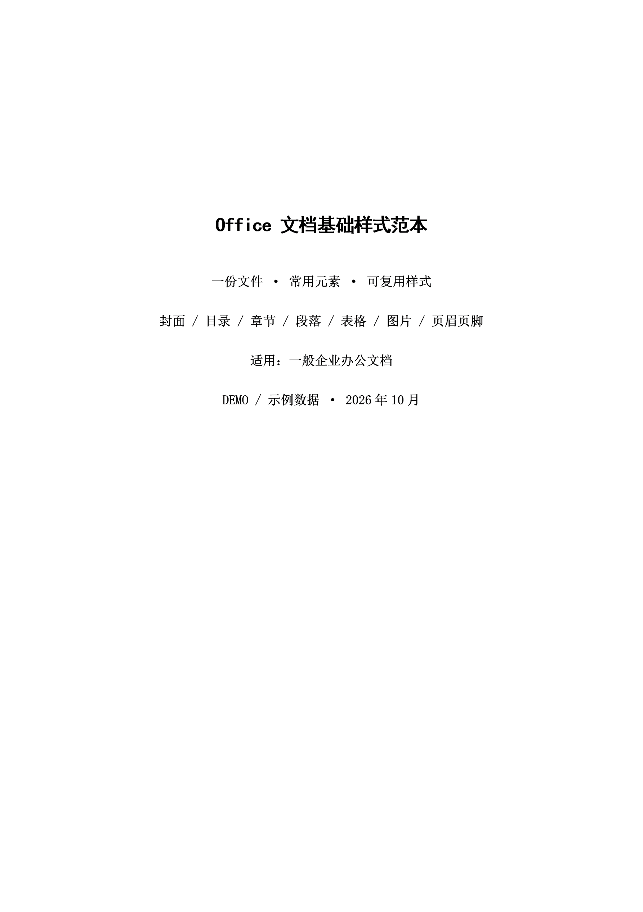

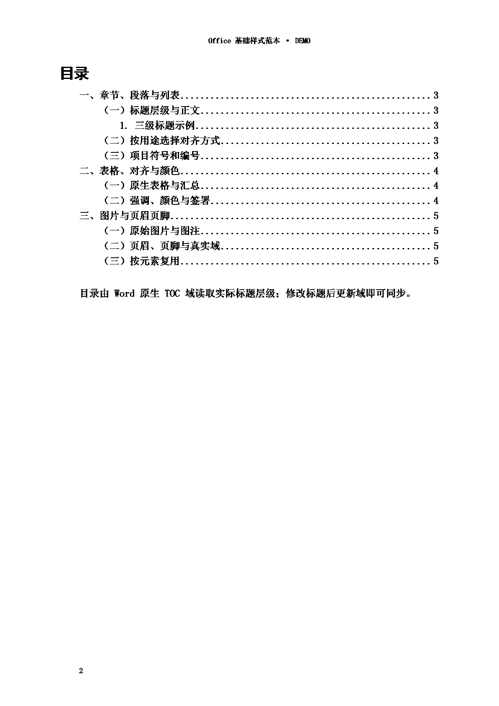

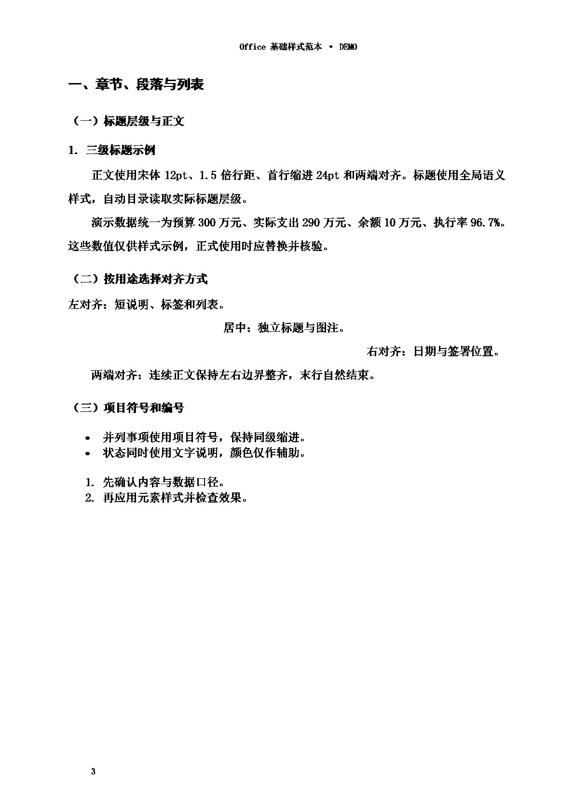

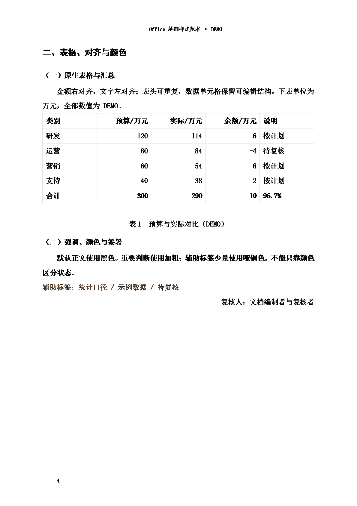

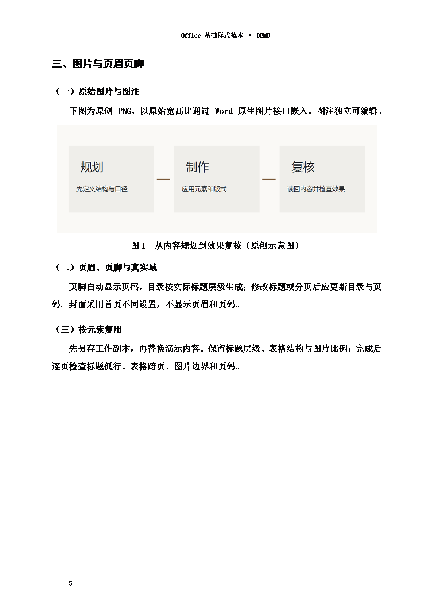

## Excel element style atlas

Two sheets: base styles, and data with charts. Bold titles, auto column widths, wrapping and auto row heights, number formats, native tables, filters, freeze panes, formulas and native charts.

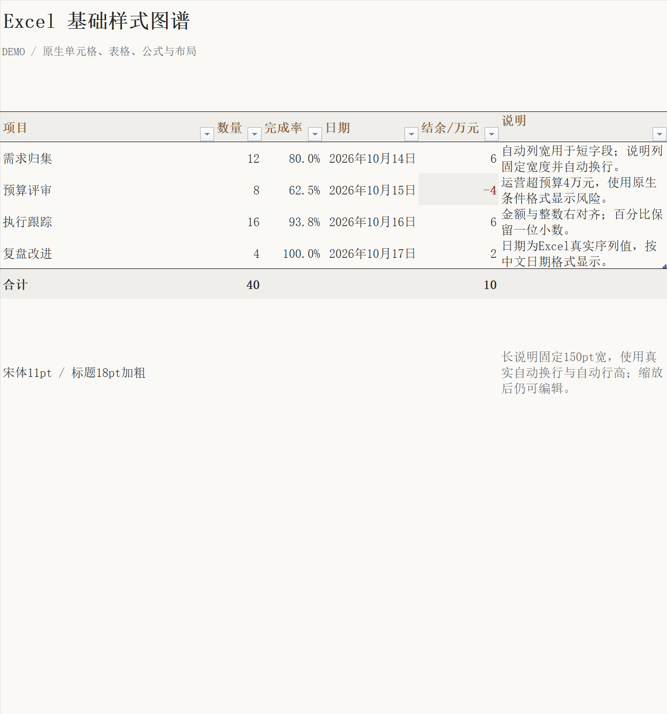

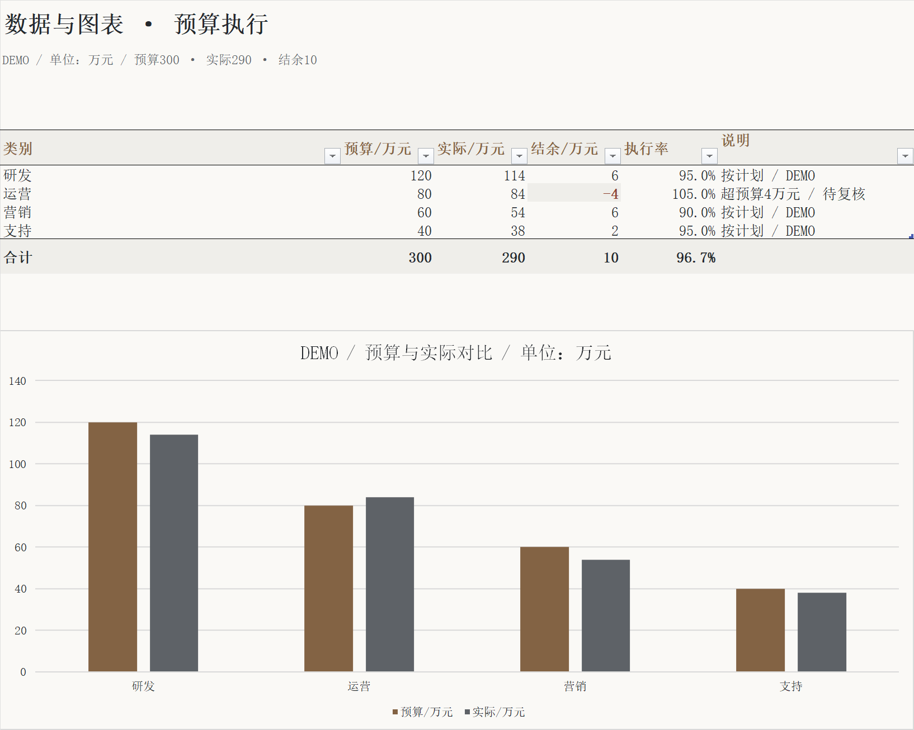

## PowerPoint element style atlas

Type hierarchy, shapes, native tables, data charts, embedded images, two-column layouts, flows, timelines, grids and colour roles. Titles in SimHei, body and table/chart labels in KaiTi.

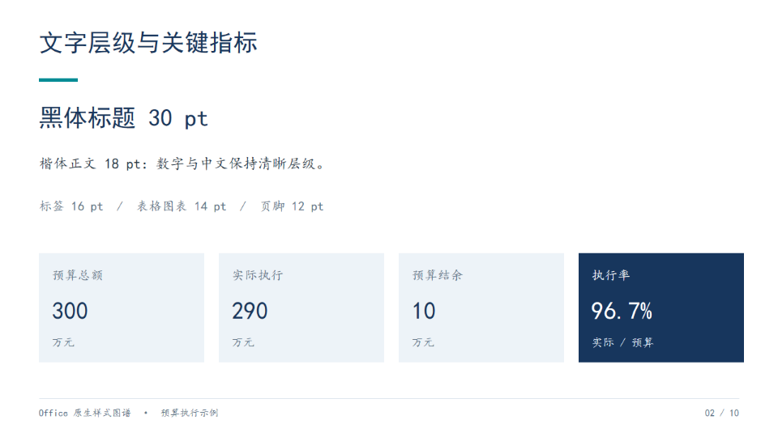

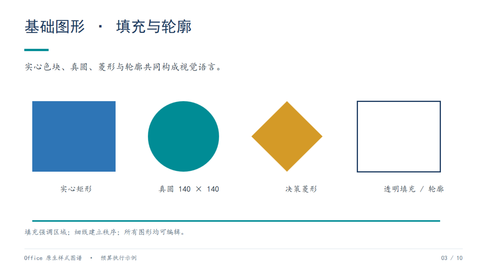

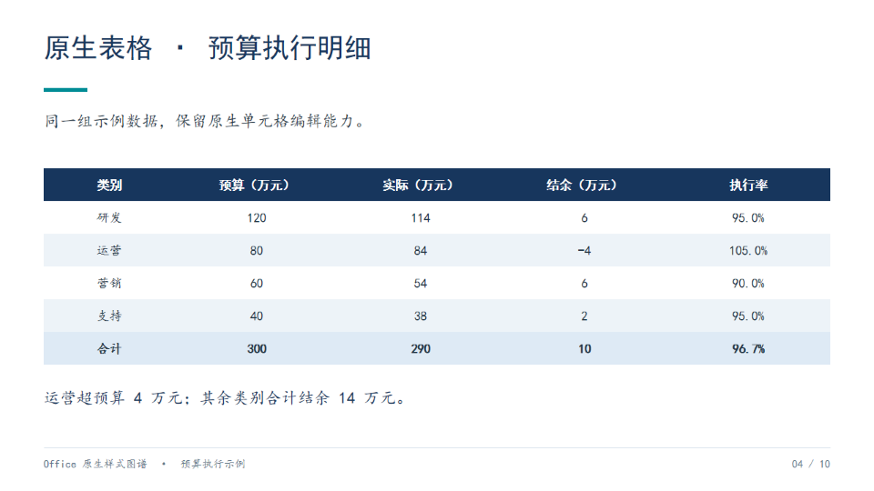

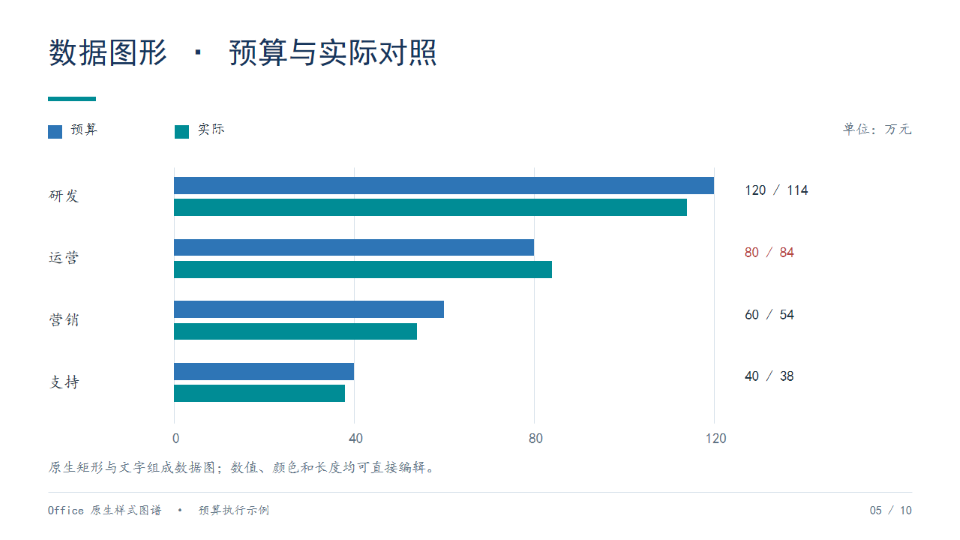

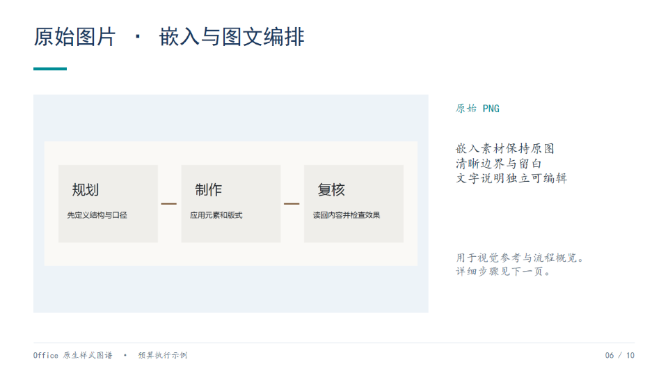

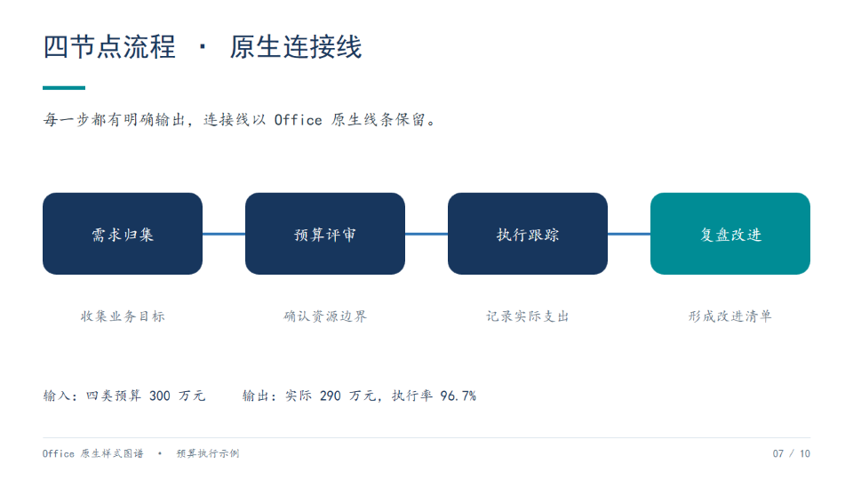

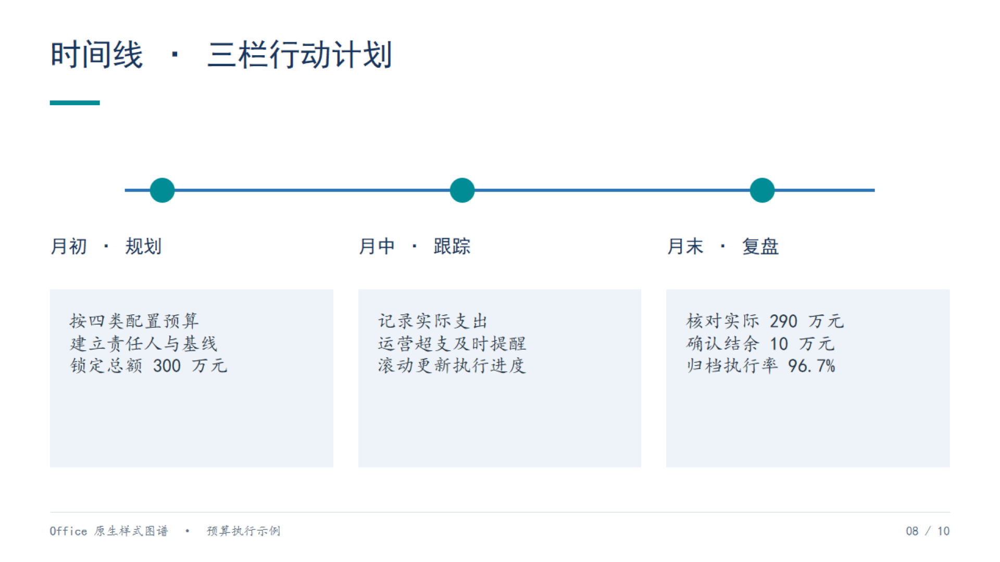

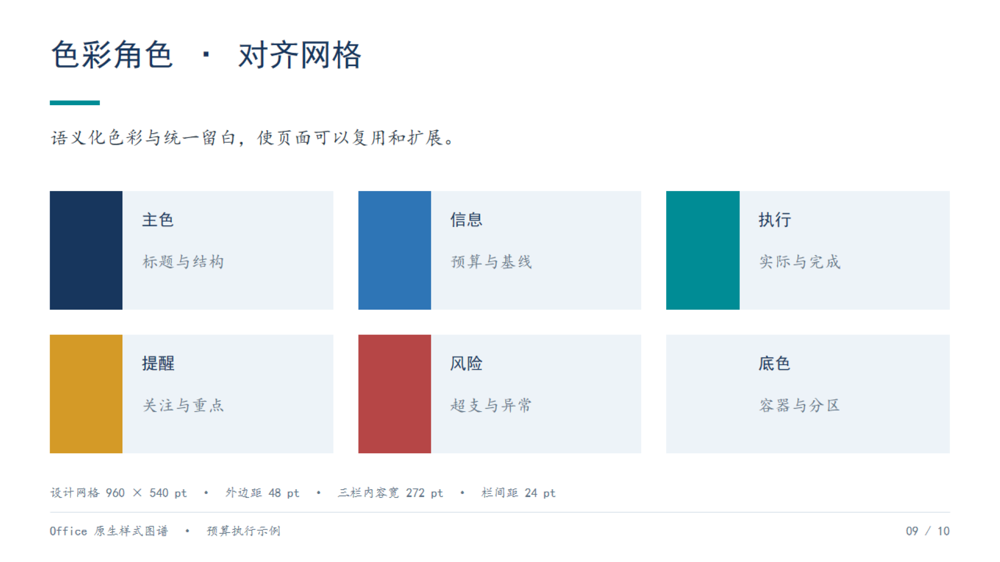

---

Data is DEMO sample data. The Word table of contents and page numbers are live fields, Excel charts and PowerPoint tables keep their native editable structure, and PowerPoint data charts are editable shapes. Every modification was executed through the plugin, and the exports and screenshots are native Office evidence.
